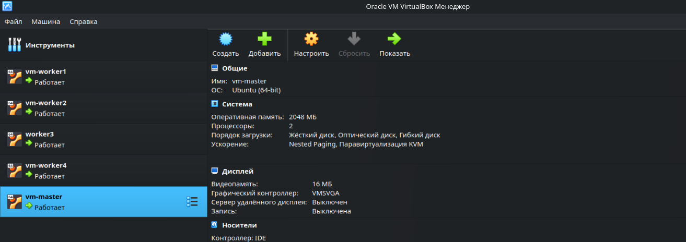
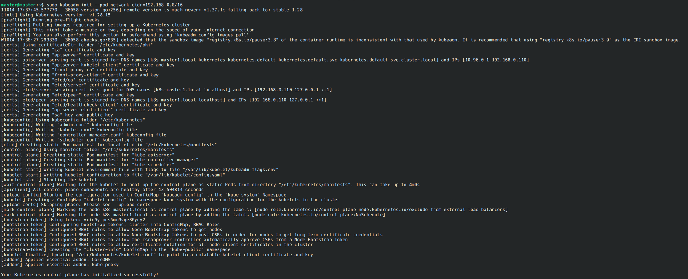
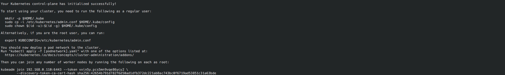
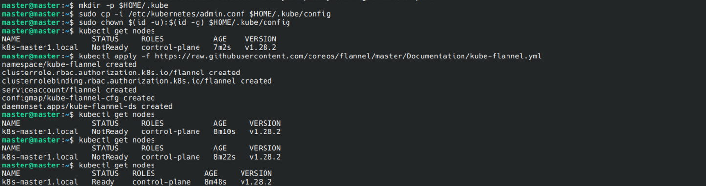
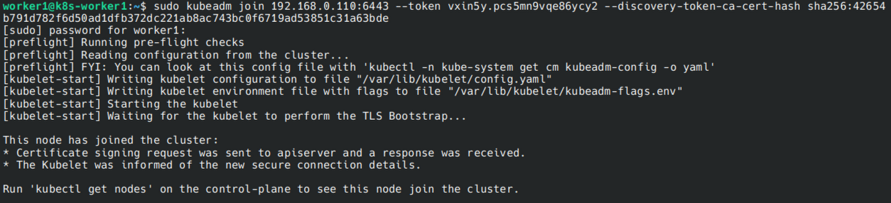
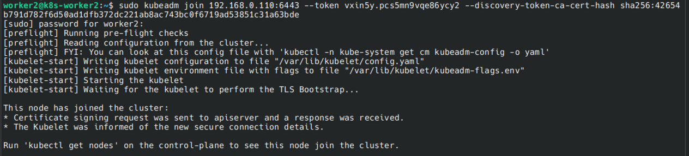
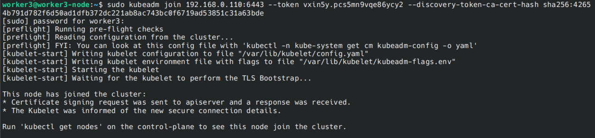
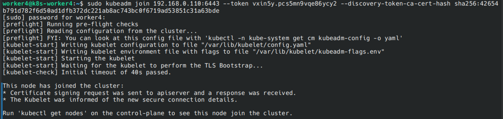
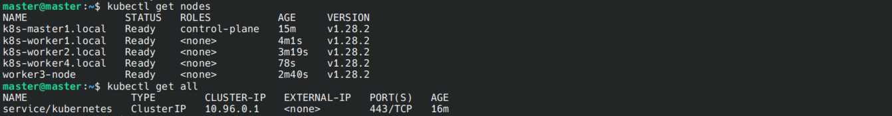

# Домашнее задание к занятию «Установка Kubernetes» Тукаев Айрат

### Цель задания

Установить кластер K8s.

### Чеклист готовности к домашнему заданию

1. Развёрнутые ВМ с ОС Ubuntu 20.04-lts.


### Инструменты и дополнительные материалы, которые пригодятся для выполнения задания

1. [Инструкция по установке kubeadm](https://kubernetes.io/docs/setup/production-environment/tools/kubeadm/create-cluster-kubeadm/).
2. [Документация kubespray](https://kubespray.io/).

-----

### Задание 1. Установить кластер k8s с 1 master node

1. Подготовка работы кластера из 5 нод: 1 мастер и 4 рабочие ноды.
2. В качестве CRI — containerd.
3. Запуск etcd производить на мастере.
4. Способ установки выбрать самостоятельно.

**Выполнение:**  
  На VirtualBox создал 5 виртуальных машин с 2 ГБ оперативной памятью и 2 ядрами. Объём дисков 20 ГБ. 1 мастер и 4 рабочие ноды.  
Выполняю настройку каждой машины.  

## Подготовка окружения для установки Kubernetes  
### 1. Включаю обязательные параметры ядра Linux.  
Активирую модули и параметры для корректной работы Kubernetes.  
```
sudo modprobe overlay    # Включаю overlay файловую систему
sudo modprobe br_netfilter    # Включаю фильтрацию сетевых пакетов
```
Создаю файл /etc/sysctl.d/k8s.conf со следующим содержанием:
```
net.bridge.bridge-nf-call-iptables = 1
net.bridge.bridge-nf-call-ip6tables = 1
net.ipv4.ip_forward = 1
```
Применяю параметры:  
```
sudo sysctl --system    # Применяем все настройки из /etc/sysctl.d
```
### 2. Отключаю swap.    
Kubernetes не поддерживает работу при активном swap, поэтому отключаю его:    
```
sudo swapoff -a    # Отключение swap временно
sudo sed -i '/ swap / s/^/#/' /etc/fstab    # Отключение swap на постоянной основе
```
### 3. Устанавливаю containerd.  
```
sudo apt update
sudo apt install -y containerd
```
Для запуска containerd в качестве демона и автозапуска выполняю:  
```
sudo systemctl restart containerd
sudo systemctl enable containerd
```
## Установка необходимых компонентов Kubernetes.  

### 1. Устанавливаю kubeadm, kubelet и kubectl.    
```
sudo apt-get update
sudo apt-get install -y apt-transport-https ca-certificates curl iptables-persistent
sudo mkdir -p /etc/apt/keyrings
sudo curl -fsSL https://mirrors.aliyun.com/kubernetes/apt/doc/apt-key.gpg | sudo gpg --dearmor -o /etc/apt/keyrings/kubernetes-apt-keyring.gpg
echo 'deb [signed-by=/etc/apt/keyrings/kubernetes-apt-keyring.gpg] https://mirrors.aliyun.com/kubernetes/apt/ kubernetes-xenial main' | sudo tee /etc/apt/sources.list.d/kubernetes.list > /dev/null
sudo apt-get update
sudo apt-get install -y kubelet kubeadm kubectl
sudo apt-mark hold kubelet kubeadm kubectl    # Блокирую автоматическое обновление этих пакетов
```
Теперь сервера готовы к непосредственной инициализации Kubernetes.    

## Инициализация кластера Kubernetes.  
### 1. Инициализирую кластер на мастере (Control Plane).    
Выполнию на сервере мастер-ноды:
```
sudo kubeadm init --pod-network-cidr=192.168.0.0/16    # Указание CIDR для Flannel, подойдет и для многих других сетевых плагинов
```
В выходных данных вижу блок с командами для дальнейшей настройки:  
```
mkdir -p $HOME/.kube              # Создаем каталог для kubectl-конфига
sudo cp -i /etc/kubernetes/admin.conf $HOME/.kube/config   # Копируем конфиг
sudo chown $(id -u):$(id -g) $HOME/.kube/config           # Меняем владельца
```
И еще строку вида:
```
kubeadm join <IP>:<PORT> --token <TOKEN> --discovery-token-ca-cert-hash sha256:<HASH>
```
Сохраняю ее для добавления нод в кластер.  

### 2. Настраиваю окружение для kubectl.    
Проверяю работу kubectl:  
```
kubectl get nodes     # Список нод в кластере
```
Вижу мастер-ноду со статусом NotReady (пока не установлен сетевой плагин).

## Установка сетевого плагина (CNI).  
Без правильно настроенной сетевой подсистемы компоненты Kubernetes не смогут разворачивать поды, и весь кластер будет оставаться в статусе NotReady.
Возьму популярный сетевой плагин Flannel:  
```
kubectl apply -f https://raw.githubusercontent.com/coreos/flannel/master/Documentation/kube-flannel.yml
```
Проверяю статус ноды по команде:  
```
kubectl get nodes
```
## Присоединение рабочих нод к кластеру.  
### 1. Используйте команду kubeadm join.    
На каждом рабочем сервере выполняю команду, которую я получил ранее от kubeadm init:  
```
sudo kubeadm join <адрес_мастера>:6443 --token <token> --discovery-token-ca-cert-hash sha256:<hash>
```
Если потеряли эту строку, ее можно сгенерировать снова на мастере командой:  
```
kubeadm token create --print-join-command
```
Через несколько минут рабочие ноды отобразятся в выводе:  
```
kubectl get nodes
```
Все ноды имеют статус Ready.  

    

    

    

    

    

    

    

    

    


## Дополнительные задания (со звёздочкой)

**Настоятельно рекомендуем выполнять все задания под звёздочкой.** Их выполнение поможет глубже разобраться в материале.   
Задания под звёздочкой необязательные к выполнению и не повлияют на получение зачёта по этому домашнему заданию. 

------
### Задание 2*. Установить HA кластер

1. Установить кластер в режиме HA.
2. Использовать нечётное количество Master-node.
3. Для cluster ip использовать keepalived или другой способ.

### Правила приёма работы

1. Домашняя работа оформляется в своем Git-репозитории в файле README.md. Выполненное домашнее задание пришлите ссылкой на .md-файл в вашем репозитории.
2. Файл README.md должен содержать скриншоты вывода необходимых команд `kubectl get nodes`, а также скриншоты результатов.
3. Репозиторий должен содержать тексты манифестов или ссылки на них в файле README.md.
