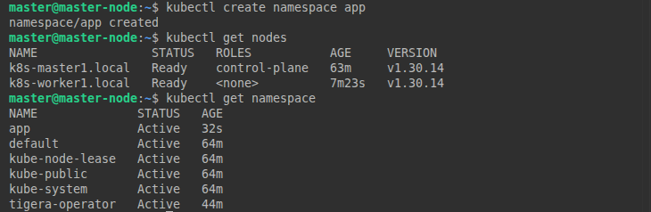
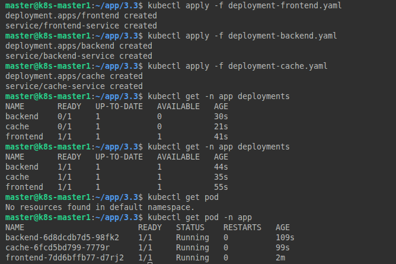
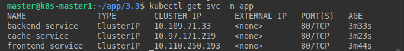
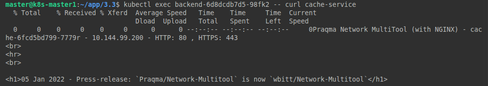
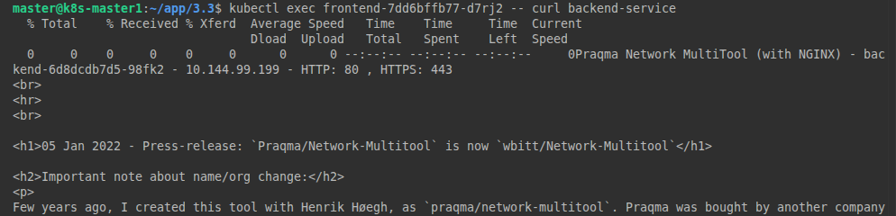
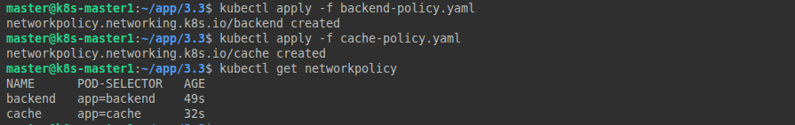
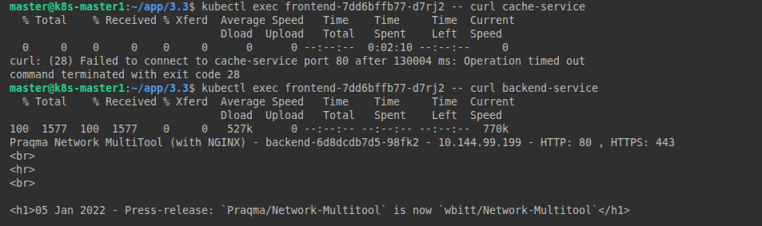
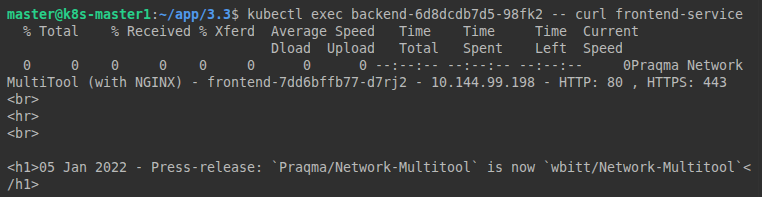
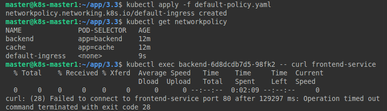
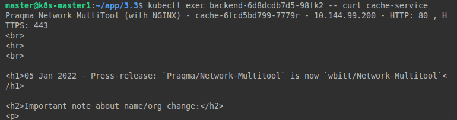

# Домашнее задание к занятию «Как работает сеть в K8s» Тукаев Айрат

### Цель задания

Настроить сетевую политику доступа к подам.

### Чеклист готовности к домашнему заданию

1. Кластер K8s с установленным сетевым плагином Calico.

### Инструменты и дополнительные материалы, которые пригодятся для выполнения задания

1. [Документация Calico](https://www.tigera.io/project-calico/).
2. [Network Policy](https://kubernetes.io/docs/concepts/services-networking/network-policies/).
3. [About Network Policy](https://docs.projectcalico.org/about/about-network-policy).

-----

### Задание 1. Создать сетевую политику или несколько политик для обеспечения доступа

1. Создать deployment'ы приложений frontend, backend и cache и соответсвующие сервисы.
2. В качестве образа использовать network-multitool.
3. Разместить поды в namespace App.
4. Создать политики, чтобы обеспечить доступ frontend -> backend -> cache. Другие виды подключений должны быть запрещены.
5. Продемонстрировать, что трафик разрешён и запрещён.

**Выполнение:**  
Создал кластер K8s с установленным сетевым плагином Calico.  
Команда для установки сетевого плагина Calico.  
```
kubectl apply -f https://raw.githubusercontent.com/projectcalico/calico/v3.33.0/manifests/calico.yaml
```
Создал манифесты.  
[Ссылка на манифест deployment-backend.yaml](https://github.com/AyratTukay/kuber-homeworks/blob/main/3.3/deployment-backend.yaml)  
[Ссылка на манифест deployment-frontend.yaml](https://github.com/AyratTukay/kuber-homeworks/blob/main/3.3/deployment-frontend.yaml)  
[Ссылка на манифест deployment-cache.yaml](https://github.com/AyratTukay/kuber-homeworks/blob/main/3.3/deployment-cache.yaml)  
[Ссылка на манифест default-policy.yaml](https://github.com/AyratTukay/kuber-homeworks/blob/main/3.3/default-policy.yaml)  
[Ссылка на манифест backend-policy.yaml](https://github.com/AyratTukay/kuber-homeworks/blob/main/3.3/backend-policy.yaml)  
[Ссылка на манифест cache-policy.yaml](https://github.com/AyratTukay/kuber-homeworks/blob/main/3.3/cache-policy.yaml)  

Команда для установки сетевого плагина Calico.  
```
kubectl apply -f https://raw.githubusercontent.com/projectcalico/calico/v3.33.0/manifests/calico.yaml
```

Создаю namespace App.  

    

Запускаю манифесты.  

    

    

Проверяю доступность сервисов:  

    

    

    

Создаю сетевые политики, чтобы обеспечить доступ frontend -> backend -> cache.  

    

Проверяю созданные политики:  

    

    

Вижу что есть доступ из backend во frontend. Создаю новую политику и проверяю.  

    

    

Созданные политики работают.  


### Правила приёма работы

1. Домашняя работа оформляется в своём Git-репозитории в файле README.md. Выполненное домашнее задание пришлите ссылкой на .md-файл в вашем репозитории.
2. Файл README.md должен содержать скриншоты вывода необходимых команд, а также скриншоты результатов.
3. Репозиторий должен содержать тексты манифестов или ссылки на них в файле README.md.
